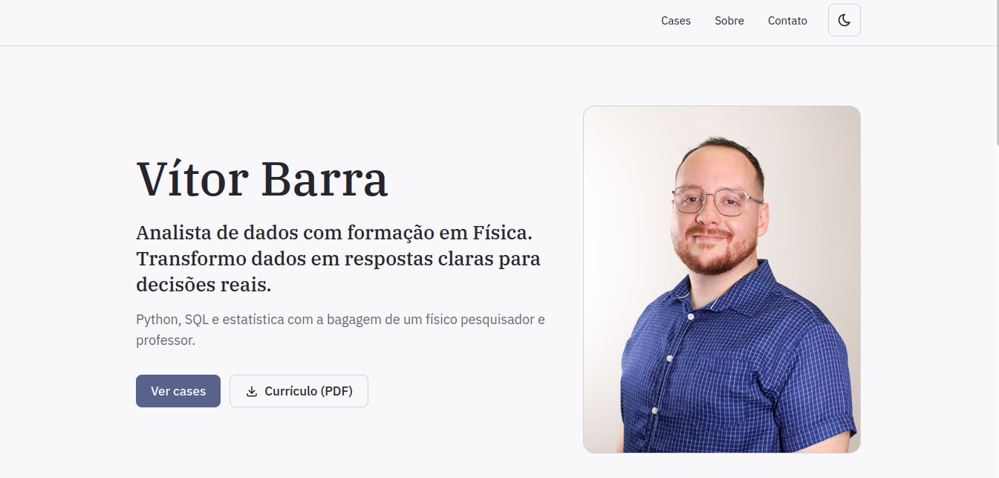
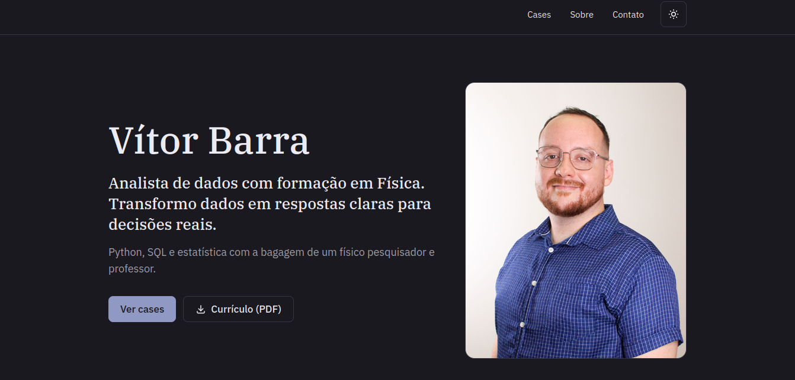

# Portfólio — Vítor Barra

Meu portifólio de Ciência de Dados com cases reais, construído utilizando meus conhecimentos prévios de React, Tailwind e Claude Code.

**Acesse:** [link do site na Vercel]

| Modo claro                                     | Modo escuro                                      |
| ---------------------------------------------- | ------------------------------------------------ |
|  |  |

## Sobre o projeto

Site para apresentar meus cases de análise e ciência de dados a recrutadores e gestores.
Cada case é contado como uma história: o problema, o que os dados mostraram, o resultado e as limitações.

## Stack

- **Vite** — ambiente de desenvolvimento e build rápidos
- **React** + **React Router** — componentes e uma página por case
- **Tailwind CSS** — estilo com tokens de cor próprios para os dois temas
- **React Icons (Tabler)** — todos os ícones do site
- **Vercel** — deploy automático a cada push na `main`

## Funcionalidades

- Modo claro e escuro, seguindo a preferência do sistema, com troca manual salva no navegador
- Layout responsivo, mobile first com adaptação para diversos tamanhos de telas.
- Conteúdo dos cases separado do código, em `src/data/cases.js`
- Gráficos com destaque só no achado principal
- Botões com área de toque de 44px e rótulos para leitores de tela

## Processo e decisões de design

- **Conteúdo antes do código:** posicionamento, "Sobre mim" e roteiro de cada case foram definidos antes de qualquer tela.
- **Paleta:** extensão da paleta do meu blog [log-narrado](https://lognarrado.vercel.app/), com um ocre como única cor quente, reservado para o achado de cada gráfico.
- **Tipografia:** família IBM Plex (Serif nos títulos, Sans no texto, Mono no código).
- **Layout:** Escolhi seguir uma linha editorial, com foto no topo e cases em duas colunas.

## Estrutura

```
src/
├── components/   # Header, Hero, CaseCard, MetricCard, BarChart...
├── data/         # conteúdo dos cases
└── pages/        # Home, CasePage, NotFound
```

## Como rodar localmente

```bash
npm install
npm run dev
```

## Como adicionar um case

Acrescente um objeto à lista em `src/data/cases.js`. A home e a página do case são geradas automaticamente a partir dele.

## Próximos passos

- [ ] **Prévia ao compartilhar cada case:** título, descrição e imagem Open Graph próprios por página, para que o link de um case no LinkedIn ou no WhatsApp mostre o case, e não a home genérica.
- [ ] **Foto mais leve:** gerar versões em AVIF/WebP em alguns tamanhos e servir com `<picture>` e `srcset`, para que o celular baixe só o tamanho de que precisa.
- [ ] **Transições suaves:** usar a View Transitions API na troca entre a home e as páginas de case e na troca de tema, respeitando `prefers-reduced-motion`.

## Contato

[LinkedIn](https://linkedin.com/in/vitorbarra) · vifebarra@outlook.com
