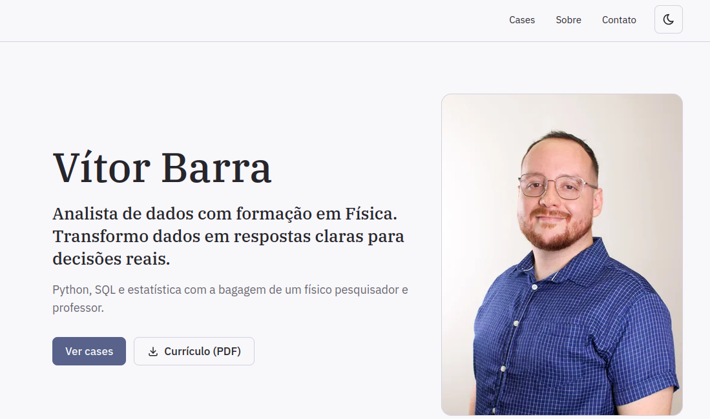
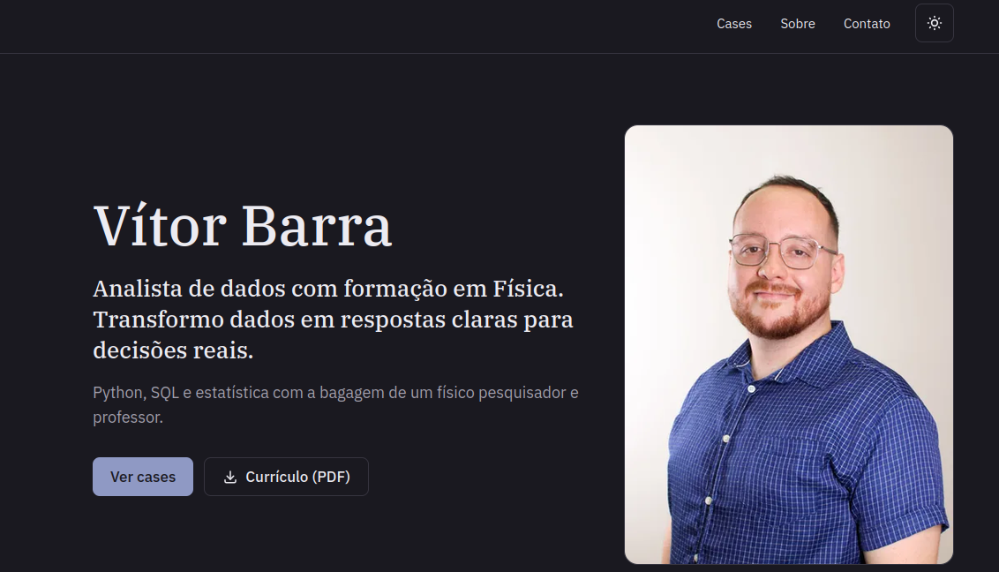

# Portfólio — Vítor Barra

Meu portfólio de Ciência de Dados com cases reais, construído utilizando meus conhecimentos prévios de React, Tailwind e Claude Code.

**Acesse:** [vitorbarra.vercel.app](https://vitorbarra.vercel.app)

| Modo claro                                     | Modo escuro                                      |
| ---------------------------------------------- | ------------------------------------------------ |
|  |  |

## Sobre o projeto

Site para apresentar meus cases de análise e ciência de dados a recrutadores e gestores.
Cada case é contado como uma história: o problema, o que os dados mostraram, o resultado e as limitações.

## Stack

- **Vite** — ambiente de desenvolvimento e build rápidos
- **React** + **React Router** — componentes e uma página por case
- **Tailwind CSS** — estilo com tokens de cor próprios para os dois temas
- **React Icons (Tabler)** — todos os ícones do site
- **oxlint** — verificação do código
- **Vercel** — deploy automático a cada push na `main`

## Funcionalidades

- Modo claro e escuro, seguindo a preferência do sistema, com troca manual salva no navegador
- Layout responsivo, mobile first com adaptação para diversos tamanhos de telas
- Conteúdo dos cases separado do código, em `src/data/cases.js`
- Gráficos com destaque só no achado principal, ou figuras prontas do repositório de cada projeto
- Rolagem suave até as seções, desligada para quem prefere menos movimento no sistema
- Foto em WebP com `srcset`, para que cada tela baixe só o tamanho de que precisa
- Currículo em PDF para download, com links clicáveis
- SEO: título, descrição e endereço canônico por página, prévia com imagem ao compartilhar o link (Open Graph), dados estruturados (JSON-LD), `sitemap.xml` e `robots.txt` gerados no build
- Botões com área de toque de 44px e rótulos para leitores de tela

## Processo e decisões de design

- **Conteúdo antes do código:** posicionamento, "Sobre mim" e roteiro de cada case foram definidos antes de qualquer tela.
- **Paleta:** extensão da paleta do meu blog [log-narrado](https://lognarrado.vercel.app/), com um ocre como única cor quente, reservado para o achado de cada gráfico.
- **Tipografia:** família IBM Plex (Serif nos títulos, Sans no texto, Mono no código).
- **Layout:** Escolhi seguir uma linha editorial, com foto no topo e cases em duas colunas.

## Estrutura

```
public/
├── cases/        # figuras de cada case, em uma pasta por slug
├── curriculo.pdf
├── foto-*.webp   # foto do Hero em dois tamanhos (e foto.jpg como reserva)
└── og-image.jpg  # imagem da prévia ao compartilhar o link
src/
├── components/   # Header, Hero, CaseCard, MetricCard, BarChart...
├── data/         # conteúdo dos cases
├── pages/        # Home, CasePage, NotFound
├── site.js       # endereço, título e descrição do site
└── useSeo.js     # título, descrição e canônico de cada página
```

## Como rodar localmente

```bash
npm install
npm run dev       # servidor de desenvolvimento
npm run build     # build de produção em dist/ (inclui sitemap e robots.txt)
npm run preview   # serve o build localmente
npm run lint      # verifica o código com oxlint
```

## Como adicionar um case

Acrescente um objeto à lista em `src/data/cases.js`. A home, a página do case e o sitemap são gerados automaticamente a partir dele.

- Use `status: 'em-breve'` para mostrar o card na home sem publicar a página; ele também fica fora do sitemap.
- Cada seção pode ter um gráfico de barras (`grafico`, com os dados em `graficos`, no mesmo arquivo) ou uma figura pronta (`imagem`). As figuras ficam em `public/cases/<slug>/`.

## Domínio

O endereço do site aparece em `src/site.js` e nas tags `og:`, no canônico e no JSON-LD do `index.html`. Se o domínio mudar, atualize os dois arquivos.

## Próximos passos

- [ ] **Prévia ao compartilhar cada case:** título, descrição e imagem Open Graph próprios por página, para que o link de um case no LinkedIn ou no WhatsApp mostre o case, e não a home genérica.
- [ ] **Foto em AVIF:** a foto já é servida em WebP com `srcset` (29 a 82 KB); uma versão AVIF reduziria um pouco mais o peso.
- [ ] **Transições suaves:** usar a View Transitions API na troca entre a home e as páginas de case e na troca de tema, respeitando `prefers-reduced-motion`.

## Contato

[LinkedIn](https://linkedin.com/in/vitorbarra) · [GitHub](https://github.com/Kotige) · vifebarra@outlook.com
